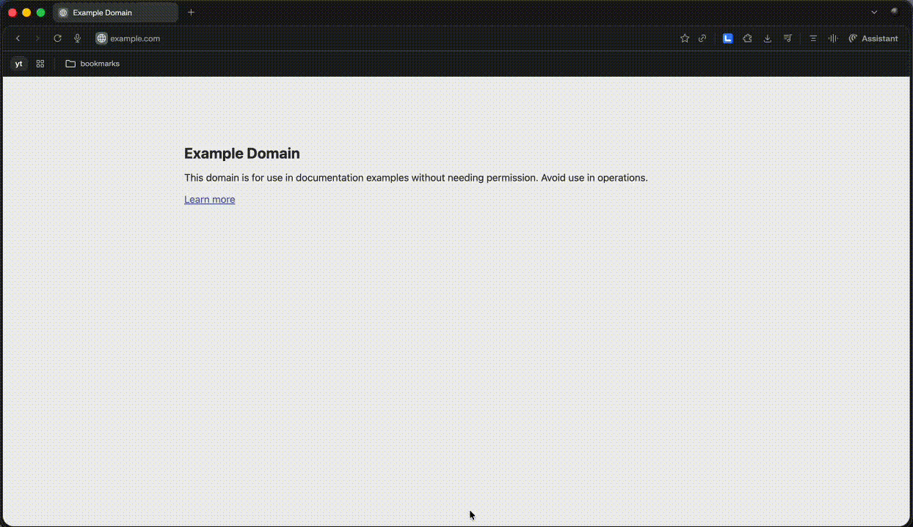

# Local-Agent Ollama

Agentic showcase:
<div align="center">

</div>

[](https://chromewebstore.google.com/detail/local-agent-ollama/mkhiohkkekffefiggoijacbgcpdfmlfp?authuser=0&hl=en)
[]()
[](https://github.com/ollama/ollama)
[](https://openrouter.ai)

A private, hybrid AI browser extension powered by [Ollama](https://ollama.com) and [OpenRouter](https://openrouter.ai). Chat with any webpage, summarize tabs, and automate browser tasks — runs locally on your machine, with optional cloud model support.

## Features

- **Chat** — ask questions about any open tab using interactive `@tabname` mention pills
- **Agent mode** — AI can navigate, click, type, and read pages autonomously with configurable step controls
- **Hybrid Inference** — run 100% locally with Ollama or connect to OpenRouter for cloud models (Deepseek V4.1, GPT-6, Nemotron 3.5)
- **Tool calling** — uses native tool calling for capable models (recommended: 70B+ or frontier models)
- **Voice Dictation** — click to dictate prompt messages directly into the composer
- **Settings Dashboard** — configure endpoints, test model connections, and manage agent limits

## Requirements

- [Ollama](https://ollama.com) running locally (for local models) and/or an [OpenRouter](https://openrouter.ai) API key (for cloud models)
- Chrome 116+

## Installation 

1. Clone or download this repo
2. Open Chrome and go to `chrome://extensions`
3. Enable **Developer mode** (top right)
4. Click **Load unpacked** and select the repo folder
5. (Optional) Start Ollama: `ollama serve`

> If Ollama blocks requests from the extension, restart it with:
> ```bash
> OLLAMA_ORIGINS="*" ollama serve
> ```

## Usage

- Click the extension icon or press `Cmd+E` (or `Ctrl+E`) to open the side panel
- Select a model from the drawer (categorized into local Ollama models and cloud OpenRouter models)
- **Chat mode** — type a message, use `@` to search and insert open tab pills
- **Agent mode** — switch to Agent mode, then describe a task for the AI to complete in your browser
- **Settings** — click the Settings icon to add OpenRouter models, configure endpoints, and customize max step limits

## File Structure

```
manifest.json              — Extension manifest (MV3)
service-worker-loader.js   — Background service worker, Ollama/OpenRouter API, agent loop
content.js                 — Content script: accessibility tree, tool execution
sidepanel.html/css/js      — Side panel UI and model shelf
settings.html/css/js       — Settings dashboard for providers and agent controls
assets/                    — Content scripts injected into pages
```
